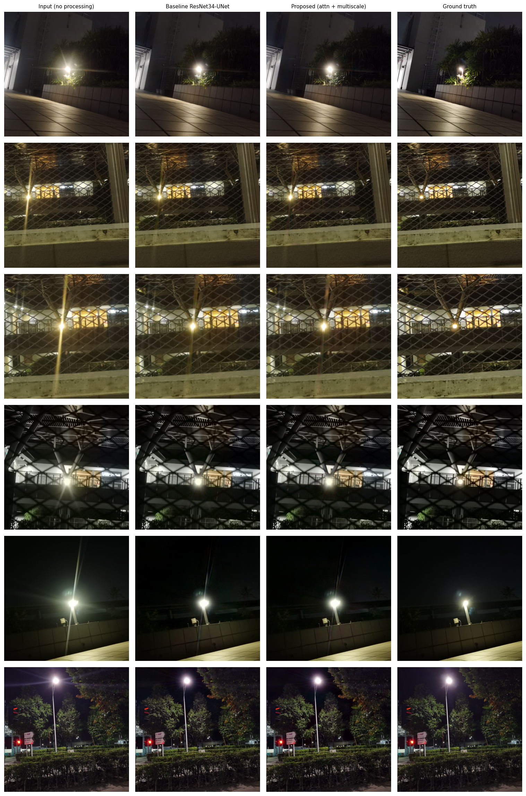

# Nighttime Lens Flare Removal (Flare7K++)

Supervised image-to-image restoration: nighttime image with lens flare -> flare-reduced image.
We compare a **ResNet-34 U-Net baseline** with a **proposed variant that adds attention gates on the skip
connections and a multi-scale dilated / global-context bottleneck** (NFR-Net-inspired; a student
adaptation, not a reproduction of NFR-Net).

Official dataset / loader: https://github.com/ykdai/Flare7K (S-Lab License 1.0).

## Final pipeline (start here)
**`notebooks/Flare_Removal_Final.ipynb`** is the final, self-contained notebook that produced every number below.
It runs top to bottom on Kaggle (GPU T4, Internet ON): clones the official Flare7K repo, builds a
leakage-safe train/val split, caches 5000 train / 300 val pairs, trains both models, evaluates on the official
test sets and draws the figures.

| Setting | Value (identical for both models) |
|---|---|
| Training pairs | generated at 512 px with the official Flare7K++ generator, random 256 crops + flips |
| Split | backgrounds, flares, light sources and reflective flares disjoint between train / val |
| Encoder | ImageNet-pretrained ResNet-34; residual output `out = input - predicted_flare` |
| Loss | flare-weighted L1 (x4 on flare pixels) + 0.1 x (1 - SSIM) |
| Optimiser | AdamW, LR 3e-4, OneCycle schedule, mixed precision, batch 8 |
| Budget | 120 epochs or 120 min per model (baseline: 120 epochs, proposed: 99 epochs) |
| Test | official Flare7K++ test sets, 100 real + 100 synthetic images, full 512x512 |

## Results (final run, v4)
Test-set PSNR (dB) / SSIM. "Input (no processing)" is the flare image compared directly with the clean target;
a model removes flare only if it scores above that row.

| Model | Params | Real PSNR | Real SSIM | Synthetic PSNR | Synthetic SSIM | Time / img (T4) |
|---|---|---|---|---|---|---|
| Input (no processing) | - | 22.56 | 0.8609 | 22.77 | 0.9244 | - |
| **Baseline ResNet-34 U-Net** | 24.5 M | **26.94** | **0.8637** | **28.45** | **0.9376** | 47 ms |
| Proposed (attention + multi-scale) | 26.7 M | 26.75 | 0.8595 | 28.20 | 0.9370 | 52 ms |

Both models clearly remove flare (+4.2 to +5.7 dB over the input). With the full 2-hour budget the baseline is
slightly ahead (~0.2 dB); in the shorter earlier runs the proposed model was slightly ahead on real images
(see below). We therefore do **not** claim that the attention / multi-scale additions improve results: the
difference is small and changes sign with the training budget.

Figures: `results/final_v4/figures/` (`real_comparison.png`, `synthetic_comparison.png`, `training_curves.png`).
Raw metrics: `results/final_v4/metrics/test_metrics.json`; per-epoch history: `results/final_v4/history_*.json`.



### Development runs (real test PSNR / SSIM)
| Run | Change | Baseline | Proposed |
|---|---|---|---|
| v1 | 256 px pairs (center crop), plain L1 | 26.09 / 0.860 | 26.23 / 0.867 |
| v2 | pairs generated at 512 px, random 256 crops | 25.93 / 0.870 | 26.22 / 0.867 |
| v3 | + flare-weighted L1, 70 epochs / 80 min | 26.43 / 0.867 | 26.53 / 0.848 |
| **v4 (final)** | 120 min per model | **26.94 / 0.864** | **26.75 / 0.859** |

Files: `results/earlier_runs/`.

### Failure analysis
`results/failure_analysis_v3/` holds per-image metrics on the real test set. The v3 proposed model was worse than the
unprocessed input on 20 / 100 real images. Most of these had only mild flare (input already high PSNR), so the model
over-corrected and removed real light. The images with the biggest drops are in `failure_cases.png`.

### Checkpoints
Checkpoints (`*.pth`, 60-300 MB) are not stored in GitHub. They are written by the notebook to
`checkpoints/{baseline,proposed}/best.pth`.

## Earlier modular code (team template)
`src/`, `configs/` and notebooks `01`-`04` / `final_pipeline.ipynb` are the original team scaffold
(plain U-Net trained from scratch). It learned to copy its input and did not remove flare, which led to the
pretrained-encoder design in `Flare_Removal_Final.ipynb`. It is kept for reference.

## Repository layout
```
notebooks/   01_dataset, 02_baseline, 03_improved_model, 04_evaluation, final_pipeline
src/data/        dataset.py, transforms.py          (Member 1)
src/models/      unet.py                            (Member 2)
                 attention.py, improved_unet.py     (Member 3)
src/training/    train.py, losses.py                (shared loop, same settings for all models)
src/evaluation/  metrics.py, evaluate.py            (Member 4)
src/inference/   predict.py                         (Member 4)
configs/default.yaml     shared settings
docs/            team plan, interface contract, data notes, experiment log
results/         figures/, metrics/  (small files only)
```
Large files (archives, extracted data, checkpoints) live in **Google Drive**, never in GitHub.

## Interface contract (do not change silently)
```
batch["input"]  : [B,3,H,W] RGB float32 in [0,1]
batch["target"] : [B,3,H,W] RGB float32 in [0,1]
prediction = model(batch["input"])   # [B,3,H,W] RGB in [0,1]
```

## Quick start (Colab)
1. Mount Drive, `git clone` this repo into `/content`, `pip install -r requirements.txt`.
2. Member 1: download Flare7K++ + background archives (links in the official README) into
   `Drive/Flare_Removal_Project/data/archives/`, extract to `/content/flare_data`, run the OFFICIAL
   generator, write pairs to `/content/flare_pairs/{input,target}/`. Verify >= 5 pairs (notebook 01).
3. Members 2/3 train: `fit(cfg, "unet")` / `fit(cfg, "attention_multiscale")` (notebooks 02/03). Resumable.
4. Member 4 evaluates with `04_evaluation.ipynb`; `final_pipeline.ipynb` loads saved checkpoints only.

Smoke test without data: `python -m tests.smoke_test`

## Ablations (template plan)
The template planned A `unet`, B `attention`, C `multiscale`, D `attention_multiscale`. Because of the GPU quota, the final
study ran only **A (baseline) and D (proposed)**, both on the ResNet-34 U-Net (see Results above).
